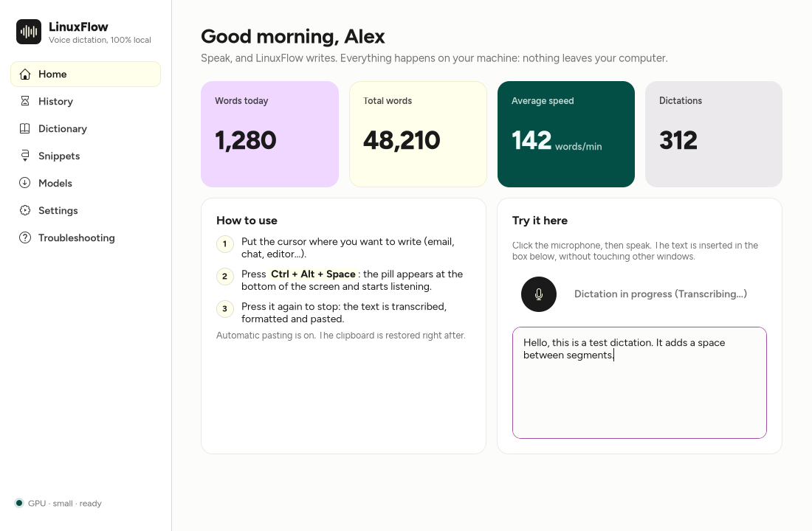
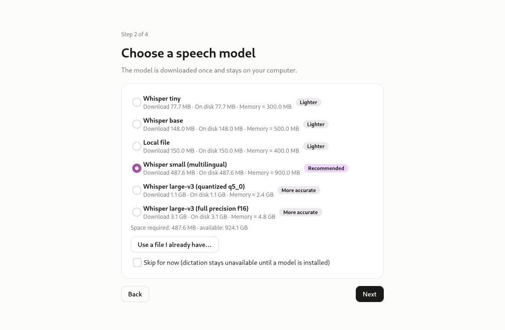
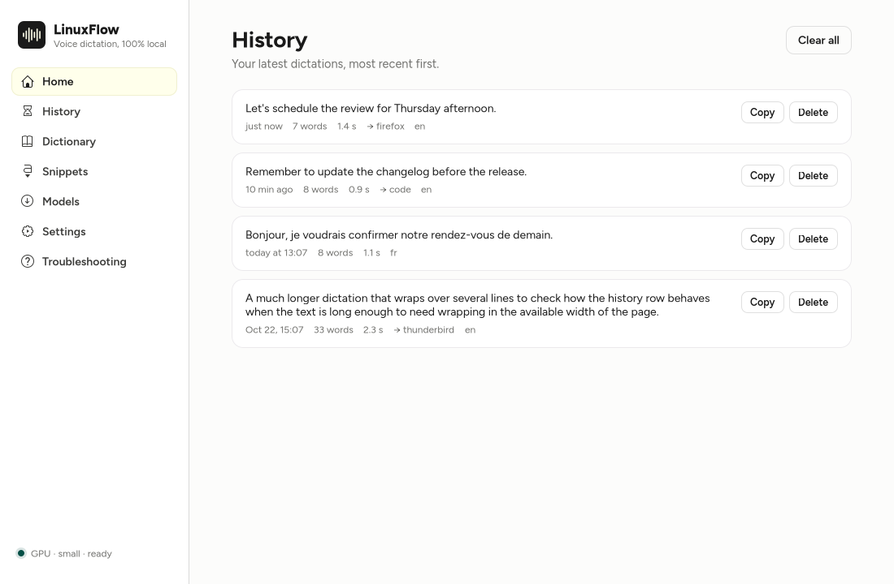
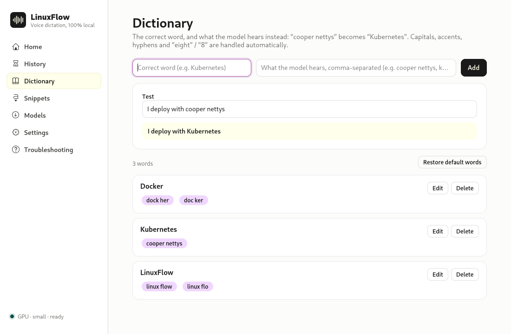
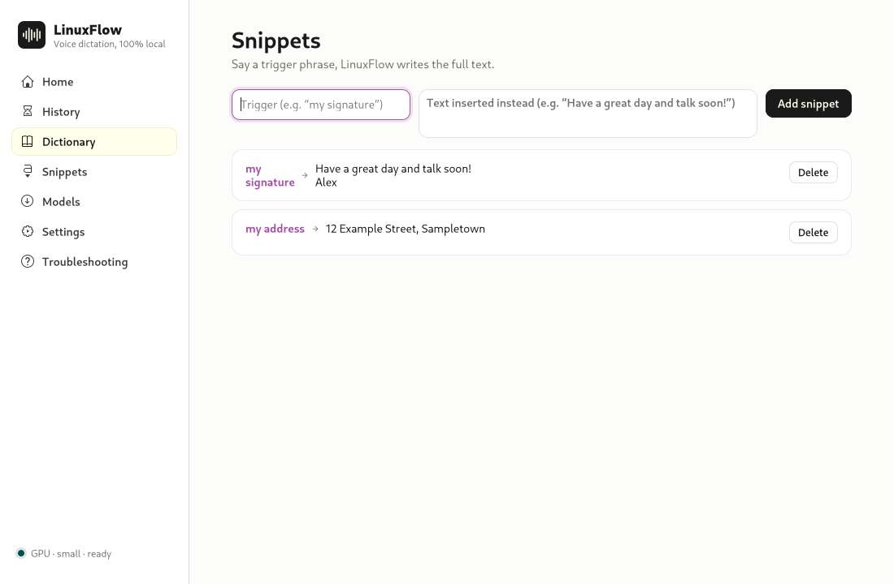
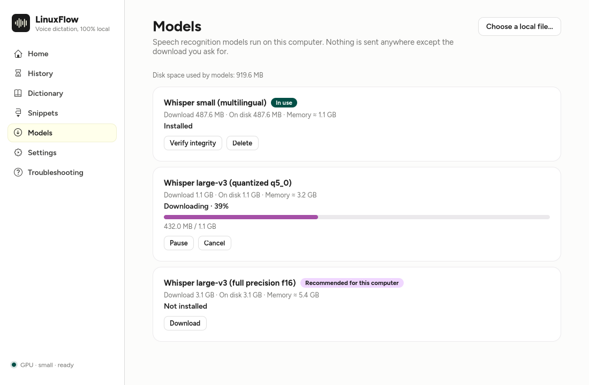
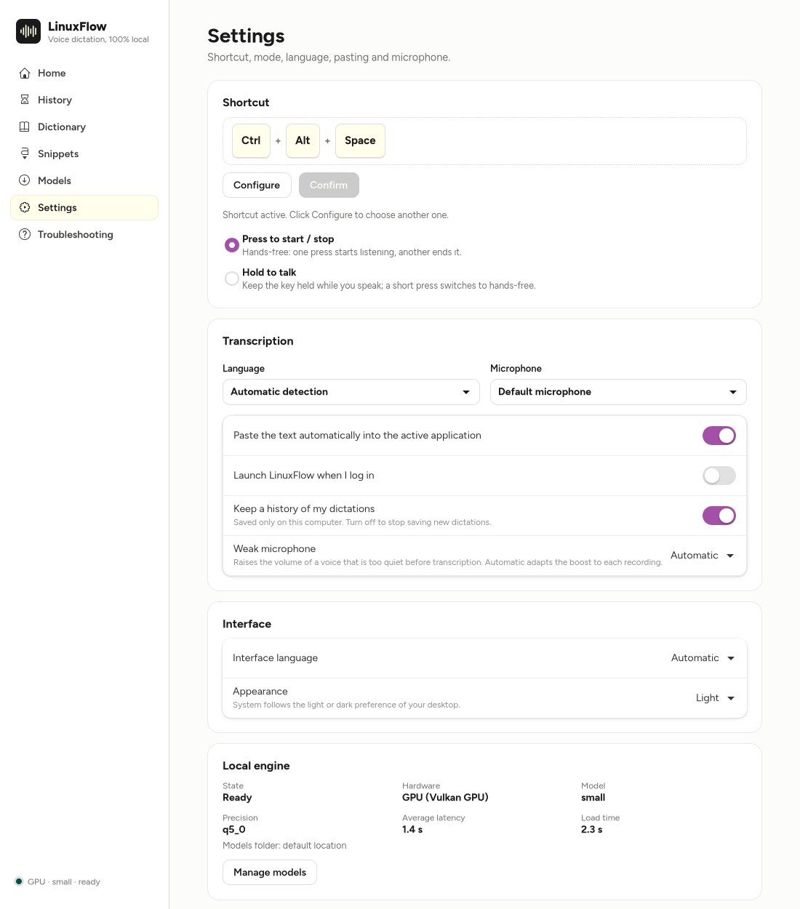
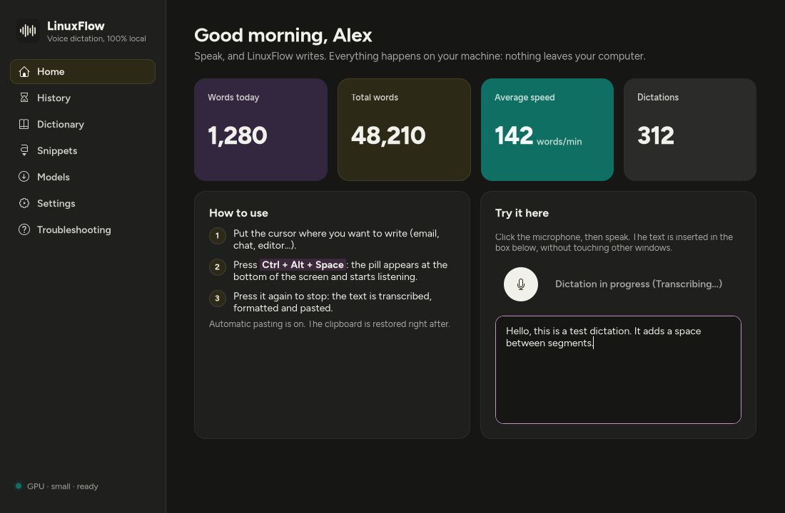

<p align="center">
  
</p>

<h1 align="center">LinuxFlow</h1>

<p align="center">
  Offline speech-to-text dictation for Linux, powered by Whisper.
</p>

LinuxFlow is a voice dictation tool for Linux that runs **entirely on your computer**. Press a
shortcut, speak, and the transcribed text is pasted into the application you are using. Speech
recognition is done locally by [Whisper](https://github.com/ggml-org/whisper.cpp) models; no
audio or text ever leaves your machine.

It is written in Rust with a GTK 4 / libadwaita interface. The interface is available in English
and French.

<p align="center">
  
</p>

## Features

- **100 % local** speech-to-text (whisper.cpp), with GPU acceleration through Vulkan and an
  automatic CPU fallback. No CUDA or ROCm needed.
- **Global shortcut configured inside the application**, on KDE Plasma, GNOME, XFCE, Cinnamon,
  MATE, Sway, Hyprland and other X11 / Wayland desktops. If the key is already used, LinuxFlow tells
  you which application owns it.
- Toggle mode and push-to-talk, automatic pasting into the focused application (the text stays in
  the clipboard when pasting is not possible).
- Custom dictionary, text snippets, automatic text formatting, history.
- **Weak microphone** setting (automatic by default) and microphone choice.
- **Light and dark theme**: follows the light or dark preference of your desktop by default (GNOME,
  KDE Plasma and any desktop that implements the XDG appearance setting), live, or can be forced
  from the settings or the first-launch wizard.
- First-launch wizard: language, appearance, model (the recommended one is preselected), shortcut.
- System tray icon, floating recording pill, launch at login (optional).
- Only one Whisper model is used at a time. Models are downloaded from Hugging Face when *you*
  ask for it; this is the only network access LinuxFlow ever makes.

## Status

LinuxFlow is developed and tested mainly on KDE Plasma (Wayland) on x86-64. It has also been tested on Ubuntu 24.04
(GNOME 46, Wayland), in a virtual machine.
The Sway, Hyprland and X11 shortcut and paste paths are covered by automated tests with
simulated desktops, but have not been verified on real sessions yet; reports are welcome.

## Screenshots

In the order of the first launch, then of the application menu. The interface and the model catalogue
are the real ones; the dictated texts, the statistics and the history are demo data.

### 1. First-launch wizard



### 2. Home


### 3. History



### 4. Dictionary



### 5. Snippets



### 6. Models



### 7. Settings



### 8. Light and dark theme

LinuxFlow follows the light or dark preference of your desktop, or you can force one in the settings.

| Light | Dark |
|---|---|
|  |  |

## Installation

LinuxFlow is distributed in two forms. Both contain the same application.

### AppImage (no installation)

```sh
chmod +x LinuxFlow-<version>-x86_64.AppImage
./LinuxFlow-<version>-x86_64.AppImage
```

The AppImage bundles GTK 4 and libadwaita, so it runs on distributions that do not ship them.
It needs a glibc-based x86-64 system (glibc 2.39 or newer) with the usual graphics, ALSA and
Vulkan libraries.

### Archive with installer

```sh
tar -xzf linuxflow-<version>-x86_64.tar.gz
cd linuxflow-<version>-x86_64
./install.sh --dry-run     # shows what would be done, changes nothing
./install.sh               # installs under ~/.local (no root needed)
sudo ./install.sh          # installs for all users under /usr/local
```

The installer verifies the checksums, checks the minimum GTK (>= 4.12), libadwaita (>= 1.4) and
glibc versions, and **prints** the package command for your distribution when a library is
missing (it never installs packages). It does not enable autostart and does not touch your
settings. Re-run it to upgrade. Options: `--prefix DIR`, `--dry-run`, `--help`,
`--with-uinput-rule`.

### Uninstall

Use the uninstaller that was installed with the application. It removes exactly the files the
installer recorded (nothing else) and keeps your own data unless you ask otherwise.

```sh
# installed for your user (./install.sh)
~/.local/share/linuxflow/uninstall.sh            # keeps your settings, history and models
~/.local/share/linuxflow/uninstall.sh --purge    # also deletes them, after listing and confirmation

# installed for all users (sudo ./install.sh): removes the program only
sudo /usr/local/share/linuxflow/uninstall.sh
```

Your data lives in your home directory, never in the installation prefix:

| What | Where |
|---|---|
| Settings and dictionary | `~/.config/linuxflow/` |
| History | `~/.local/share/linuxflow/` |
| Downloaded models (the largest part) | `~/.cache/linuxflow/models/` |
| Logs | `~/.local/state/linuxflow/` |

`--purge` (user installation) deletes these four folders and the autostart entry, after showing
the list and asking for confirmation. After a system-wide uninstall, delete your data yourself, as
your normal user (a `sudo --purge` would act on root's home directory):

```sh
rm -rf ~/.config/linuxflow ~/.local/share/linuxflow ~/.cache/linuxflow ~/.local/state/linuxflow
```

To delete only the models: `rm -rf ~/.cache/linuxflow/models`.

The **AppImage** installs nothing: to remove it, delete the file. The folders above stay (delete
them yourself for a complete removal). If AppImageLauncher offered to integrate it, it also copied
the file to `~/Application/` and created menu entries (`~/.local/share/applications/appimagekit_*`);
remove those as well.

Supported distributions, required libraries and package names: [DEPENDENCIES.md](DEPENDENCIES.md).
Older systems can build from source: [BUILD.md](BUILD.md).

## First launch

1. Choose the interface language (Automatic, English or Français).
2. Pick a speech model. LinuxFlow detects your hardware and recommends one; without a usable GPU
   it never recommends the large model. Nothing is downloaded when you install the application:
   the download starts only after you confirm, with resume and SHA-256 verification. You can also
   use a model file you already have, or skip this step and install one later from the *Models*
   page.
3. Choose your shortcut with **Configure**, press the keys you want, then **Confirm**.

## Using LinuxFlow

Press the shortcut to start dictating and press it again to stop (or hold it, in push-to-talk
mode). The text is pasted where your cursor is.

The running instance can be controlled from the command line, for example from a key binding:

```sh
linuxflow --toggle   # start or stop dictation
linuxflow --start    # start dictation
linuxflow --stop     # stop and transcribe
linuxflow --cancel   # cancel the current dictation
linuxflow --quit     # quit the running instance
```

## How the shortcut works on each desktop

| Session | Method |
|---|---|
| X11 (XFCE, Cinnamon, MATE, KDE, GNOME) | key grab by LinuxFlow |
| KDE Plasma (Wayland) | KDE global shortcut service (`KGlobalAccel`) |
| GNOME 46 and later (Wayland) | custom keyboard shortcut calling `linuxflow --toggle` (toggle only); see [docs/gnome-support.md](docs/gnome-support.md) |
| Sway, Hyprland | key binding set through the compositor's own control socket |
| Others | XDG GlobalShortcuts portal, otherwise optional evdev capture |

Reading keyboards directly (evdev) is **off by default** because it requires membership of the
`input` group, which lets a program read every key you type. The installer never changes your
groups.

## Troubleshooting

- **GPU not used.** Install the Vulkan loader and your GPU driver (`vulkaninfo --summary` must
  list your GPU). Force a device with `LINUXFLOW_DEVICE` (`gpu`, `cpu` or a Vulkan index).
- **Text not pasted.** Pasting needs permission to send keys (a portal consent on Wayland). If it is
  refused or revoked, the text is left in the clipboard. Some desktops show a notice such as
  "remote control started" while LinuxFlow sends the paste keys.
- **Generic gear icon in the dock with the AppImage.** The AppImage registers its launcher entry and icon under
  `~/.local/share` the first time it runs; restart it (and log out and in if GNOME keeps the old cache). It does
  nothing when LinuxFlow is installed system-wide (`install.sh`), and removes the entry it wrote earlier. Delete
  `~/.local/share/applications/io.github.ITchrisDEB.LinuxFlow.desktop` and the matching icons to undo it.
- **No tray icon on GNOME.** GNOME needs the AppIndicator extension to show tray icons (Ubuntu
  ships it enabled); the application stays fully usable from its window.
- **"Not needed", "Not offered", "CPU mode" or "Optional" in the compatibility report** are not faults: they mean
  the component does not apply on your desktop or is replaced by another mechanism. Only a warning with a
  "How to fix" entry is a real limitation.
- **"Sorry, Ubuntu has experienced an internal error" after a paste (Ubuntu 24.04, GNOME 46).** The desktop's own portal
  service (`xdg-desktop-portal`) crashed, not LinuxFlow; choose "Do not send". LinuxFlow reconnects on its own. Details in
  [docs/gnome-support.md](docs/gnome-support.md).
- **Clipboard managers** (Klipper, cliphist) may record the text LinuxFlow places in the
  clipboard to paste it.

## Privacy

Everything runs locally. There is no telemetry and no local server. History is stored in your data
directory with owner-only permissions; it can be disabled, cleared from the *History* page, and is
removed by `uninstall.sh --purge`. Directories follow the XDG specification and can be moved with
`LINUXFLOW_CONFIG_DIR`, `LINUXFLOW_DATA_DIR`, `LINUXFLOW_CACHE_DIR`, `LINUXFLOW_STATE_DIR` and
`LINUXFLOW_MODEL_DIR`. Set `LINUXFLOW_OFFLINE=1` to forbid any download.

## Building and installing from source

You need Rust and the build dependencies listed in [BUILD.md](BUILD.md). The equivalent of
`make && sudo make install` is one command:

```sh
git clone https://github.com/ITchrisDEB/Linuxflow.git && cd Linuxflow
cargo xtask install              # builds, then installs for your user under ~/.local
cargo xtask install --system     # builds as you, then installs for all users under /usr/local (uses sudo)
```

Options before `--` go to the build (`--no-vulkan` for a CPU-only build), options after `--` go to
the installer (for example `cargo xtask install -- --prefix /opt/linuxflow --dry-run`). The build
itself never runs as root. To produce the packages instead of installing them:

```sh
cargo xtask dist        # target/dist/linuxflow-<version>-<arch>.tar.gz
cargo xtask appimage    # target/dist/LinuxFlow-<version>-<arch>.AppImage
```

Uninstall exactly as described above.

## Contributing

See [BUILD.md](BUILD.md). The whole quality gate (formatting, lints, tests, licence and
dependency checks, installer tests) runs with:

```sh
cargo xtask check
```

More documentation: [architecture](docs/ARCHITECTURE.md), [design decisions](docs/design-decisions.md),
[performance measurements](docs/measurements.md) and the [manual validation checklist](docs/manual-validation.md).

## Links

Source code and issues: <https://github.com/ITchrisDEB/Linuxflow>

## Licence

MIT, see [LICENSE](LICENSE). Third-party components are listed in
[THIRD_PARTY_NOTICES.md](THIRD_PARTY_NOTICES.md).
